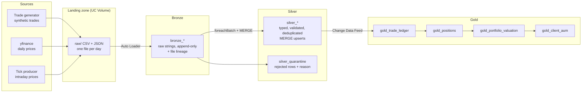

# Portfolio P&L Pipeline

An incremental Bronze/Silver/Gold data pipeline on Databricks that turns raw trade and market-price files into client positions, weighted-average cost, and realized and mark-to-market P&L.

Each daily run processes only newly landed files, upserts them with Delta `MERGE`, and recalculates only the client–asset positions that changed.

**Stack:** Databricks (Free Edition, serverless) · PySpark · Delta Lake · Auto Loader · Change Data Feed · Databricks Jobs

---

## Architecture

Orchestrated as a Databricks Job: `bronze → silver → gold`, with task dependencies and retries (see [`pipeline_job.yml`](pipeline_job.yml)).

## Data

| Source | Description |
|---|---|
| Market prices | Real daily OHLC for 12 instruments (9 US equities plus SPY, TLT and GLD ETFs), Oct 2025 – Oct 2026, from yfinance |
| Trades | **Synthetic**: ~6.4k trades for 100 clients, generated in date order, priced within ±0.5% of that day's real close, with sells capped at current holdings |
| Ticks | Intraday prices from yfinance, landed as JSON |

The generator deliberately injects duplicates and a late price correction so the pipeline's deduplication and update logic can be tested.

## Tables

| Layer | Table | One row per | Built |
|---|---|---|---|
| Bronze | `bronze_assets`, `bronze_clients`, `bronze_prices`, `bronze_trades`, `bronze_ticks` | row as landed (all strings, duplicates kept) | Auto Loader, append-only |
| Silver | `silver_assets` | asset | MERGE |
| Silver | `silver_clients` | client | MERGE |
| Silver | `silver_prices` | asset × trading day | MERGE |
| Silver | `silver_trades` | trade (latest version) | MERGE |
| Silver | `silver_ticks` | asset × tick timestamp | MERGE |
| Silver | `silver_quarantine` | rejected row, with reason and original values | Append |
| Gold | `gold_trade_ledger` | trade, with position, average cost and realized P&L after it | Incremental MERGE |
| Gold | `gold_positions` | client × asset: current quantity, average cost, cost basis, total realized P&L | Incremental MERGE |
| Gold | `gold_portfolio_valuation` | open position, valued at the latest close | Full rebuild |
| Gold | `gold_client_aum` | client: AUM, cost basis, unrealized and realized P&L | Full rebuild |

## How P&L is calculated

Positions use **weighted-average cost (WAC)**:

| Trade | Shares after | Average cost after | Realized P&L |
|---|---|---|---|
| Buy 10 @ 100 | 10 | 100 | 0 |
| Buy 10 @ 120 | 20 | 110 | 0 |
| Sell 5 @ 130 | 15 | 110 | 5 × (130 − 110) = 100 |
| Buy 5 @ 130 | 20 | (15×110 + 5×130) / 20 = 115 | 0 |

Unrealized (mark-to-market) P&L = quantity × latest close − cost basis.

Each row's average cost depends on the previous row's result, so it can't be expressed as a window function once sells are involved. It's computed with `groupBy(client_id, asset_id).applyInPandas(...)`: sequential within one client–asset history, parallel across histories.

## Key design decisions

- **Bronze is raw and append-only.** Everything that arrives is kept as strings, with source file and ingestion time. Silver and Gold can always be rebuilt from it.
- **Silver enforces a data contract.** `try_cast` to exact types (`DECIMAL(18,4)` for money, never `DOUBLE`), validation rules including referential checks against assets and clients, and failing rows quarantined with a reason rather than dropped.
- **Upserts guard against out-of-order data.** `MERGE` updates a row only when the incoming `updated_at` is newer, so a replayed old record can't overwrite a correction.
- **Gold recalculates by client–asset pair.** A corrected trade changes the average cost of every later trade in its history, so the unit of recalculation is the pair. Silver's Change Data Feed identifies which pairs changed; only those are recomputed and merged.
- **Full rebuild where it's cheap.** Valuation depends on the latest price, which changes for every position daily, so it's rebuilt each run rather than maintained incrementally.
- **Idempotent by design.** Checkpoints prevent re-reading files and batches; MERGE prevents duplicate rows. That is what makes automatic retries safe.

## Test results

Measured by landing two held-back trading days after a one-year backfill ([`05_tests`](05_tests.ipynb)):

| Test | Result |
|---|---|
| Backfill | 6,363 trades over ~260 trading days → 1,194 client–asset positions |
| Day 1: new data + duplicates | 26 trades (29 rows in Bronze); 3 duplicates removed in Silver |
| Day 1: incremental Gold | **26 of 1,194 positions recalculated (~2%)** |
| Day 2: late correction | Silver MERGE: 14 rows inserted, 1 updated in place; corrected price flowed through to Gold |
| Rerun with no new data | 0 rows changed in every table; Gold totals unchanged |
| Rebuild Silver + Gold from Bronze | Gold totals identical |
| Data quality | 0 quarantined rows, 0 oversells; positions reconcile to the sum of trades |

## Repository

| File | Purpose |
|---|---|
| `00_config` | Catalog, schema and paths; every notebook `%run`s it |
| `01_source_generator` | Simulated source: writes daily price and trade files to the landing zone |
| `01b_tick_producer` | Simulated source: writes intraday tick files |
| `02_bronze` | Auto Loader ingestion into Bronze |
| `03_silver` | Typing, validation, quarantine and MERGE into Silver |
| `04_gold` | Incremental ledger and positions; valuation and AUM |
| `05_tests` | Read-only tests for incrementality, corrections, idempotency and replay |
| `99_reset` | Destructive reset utilities (run cells individually) |
| `pipeline_job.yml` | Databricks Job definition |

## Running it

1. Import the notebooks into a Databricks workspace (Free Edition works) and set the catalog and schema in `00_config`.
2. Create the volume: `CREATE VOLUME <catalog>.<schema>.pipeline`.
3. Run `01_source_generator` to land a year of history, holding back the last two trading days.
4. Run `02_bronze`, `03_silver` and `04_gold` in order, or create the Job from `pipeline_job.yml`.
5. Follow `05_tests` to land the held-back days and verify each layer.

## Limitations and next steps

- Trades are synthetic; only the market prices are real.
- Trades on the same day are ordered by `trade_id`; a production system would use an execution timestamp.
- Valuation uses the latest daily close; intraday ticks are ingested but not yet used for pricing.
- **Next:** rebuild the Gold layer as dbt models with tests and documentation, and add a dashboard on top of Gold.
